<!-- hero*.svg comes from scripts/hero.py and wins*.svg from scripts/wins.py, both run by hand. stats*.svg and
     live/ are redrawn daily by .github/workflows/stats.yml, from public commits and a request to each live
     site; each tile in live/ links to its site, so keep the tiles in step with SITES in scripts/stats.py.
     <picture> follows the viewer's GitHub theme. -->
<a href="https://thebenzhou.com"><picture><source media="(prefers-color-scheme: dark)" srcset="./hero-dark.svg" /></picture></a>
<picture><source media="(prefers-color-scheme: dark)" srcset="./stats-dark.svg" />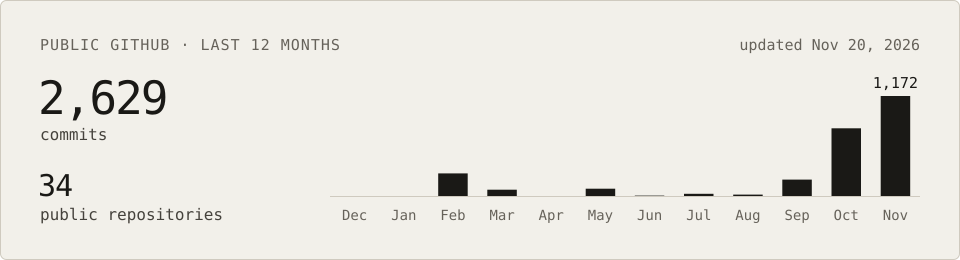</picture>
<picture><source media="(prefers-color-scheme: dark)" srcset="./live/head-dark.svg" />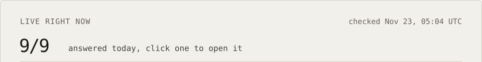</picture>
<a href="https://gurtos.com"><picture><source media="(prefers-color-scheme: dark)" srcset="./live/gurtos-dark.svg" /></picture></a><a href="https://pixie-underwriting.vercel.app"><picture><source media="(prefers-color-scheme: dark)" srcset="./live/pixie-dark.svg" /></picture></a><a href="https://uoftime.com"><picture><source media="(prefers-color-scheme: dark)" srcset="./live/uoftime-dark.svg" /></picture></a><a href="https://apps.apple.com/app/keypace/id6777376987?mt=12"><picture><source media="(prefers-color-scheme: dark)" srcset="./live/keypace-dark.svg" /></picture></a><a href="https://dataframe.space"><picture><source media="(prefers-color-scheme: dark)" srcset="./live/dataframe-dark.svg" /></picture></a><a href="https://tradex-six-dun.vercel.app"><picture><source media="(prefers-color-scheme: dark)" srcset="./live/tradex-dark.svg" /></picture></a><a href="https://huggingface.co/spaces/crackedcity/app"><picture><source media="(prefers-color-scheme: dark)" srcset="./live/crackedcity-dark.svg" /></picture></a><a href="https://routewatch-jn559.ondigitalocean.app"><picture><source media="(prefers-color-scheme: dark)" srcset="./live/routewatch-dark.svg" /></picture></a><a href="https://rcventure.ca"><picture><source media="(prefers-color-scheme: dark)" srcset="./live/rcventureca-dark.svg" /></picture></a>

---

<b>15 hackathon wins</b>, click for the 12 prizes with a public write-up

 

<picture><source media="(prefers-color-scheme: dark)" srcset="./wins-dark.svg" /></picture>

| When | Hackathon | Project | Prize |
|---|---|---|---|
| Nov 2026 | HackUTD 2026 | [Tessera](https://devpost.com/software/bean-4970h3) | Spacetime track, 2nd place |
| Oct 2026 | Cal Hacks 13.0 | [GurtOS](https://devpost.com/software/gurtos) | Atlassian prize Fetch.ai special recognition prize MLH Best Use of Solana |
| Sep 2026 | Hack the North 2026 | [Pixie](https://devpost.com/software/pixie-8vlj7g) | Intact track Federato track |
| Jul 2026 | cuHacking7 | [tradex](https://devpost.com/software/tradex-0efat7) | MLH Best Use of Solana |
| Mar 2026 | McGill AeroHacks | [OOPS](https://devpost.com/software/skygrid) | Best Use of MongoDB Atlas |
| Mar 2026 | GenAI Genesis | [Eco-Pulse](https://devpost.com/software/eco-pulse-fpbo15) | Top 2 teams, online |
| Mar 2026 | Hack Days in the 6ix | [Packwise](https://devpost.com/software/packwise-jmgtqi) | Runner up |
| Feb 2026 | Mac-a-thon | [BlindSpot](https://devpost.com/software/blindspot-zs7dwq) | MLH Best Use of ElevenLabs Best Use of Backboard.io (GitCloud) |

 

| Project | What it is | Built with |
|---|---|---|
| **[GurtOS](https://gurtos.com)** | An operating system for AI agents, built solo at Cal Hacks 13.0, where it **won an Atlassian prize, a Fetch.ai special recognition prize and MLH's Best Use of Solana**. Each agent task runs as its own Linux user in its own copy of the files, keys stay in a vault the agent never sees, and spending over budget waits for your OK. Open source, installs from its own ISO. **[Demo video](https://youtu.be/rREjU2ddIyo)** · **[Code](https://github.com/benz16107/gurtos)** | `TypeScript` `Linux` `Swift` |
| **[Pixie](https://pixie-underwriting.vercel.app)** | An insurance risk engine built solo at Hack the North 2026, where it **won the Intact and Federato tracks**. Agents decide what to look up, code computes every score and price, and a sentence with a number the tools did not return is blocked. **[Demo video](https://youtu.be/O47V32zbv20)** | `Next.js` `FastAPI` `Expo` |
| **[UofTime](https://uoftime.com)** | A timetable builder for all three UofT campuses. Pick sections on a week grid, see the walk between classes on a map, subscribe from any calendar app. No account, the timetable lives in the link. It is also an MCP server, so Claude or ChatGPT can build one in conversation. | `React` `TypeScript` `MCP` |
| **[Keypace](https://apps.apple.com/app/keypace/id6777376987?mt=12)** | A native macOS typing test, live on the Mac App Store. Version 1.1 adds a menu bar quick test that opens from any app and a per key heatmap. | `Swift` `SwiftUI` |
| **[DataFrame](https://dataframe.space)** | A node based canvas where every node runs **real Python in your browser**. CPython via Pyodide, so there is no execution server and your code never leaves the tab. Built at DRHX. | `tldraw` `Pyodide` `FastAPI` |
| **[tradex](https://tradex-six-dun.vercel.app)** | A marketplace for the agent economy. Agents pay each other per call in USDC on Solana over x402. No accounts, no API keys, reputation earned on chain. | `Next.js` `Solana` `x402` |
| **[Cracked City](https://huggingface.co/spaces/crackedcity/app)** | Road damage triage for Toronto: what to fix first, and what it costs. I built the NVFP4 quantized Qwen3.6 27B checkpoint and the [311 filing pipeline](https://github.com/benz16107/311-request). | `NVFP4` `Qwen` `Playwright` |
| **[RouteWatch](https://routewatch-jn559.ondigitalocean.app)** | Tracks how long a drive *actually* takes over weeks, not in the moment. Public demo, no login. | `Node` `Google Maps` |
| **[rcventure.ca](https://rcventure.ca)** | The website for Rotman Commerce Venture Capital, the UofT club where I am Marketing Manager. Intro video, research library, a 3D partner globe and a "would you back it?" swipe game. | `Next.js` `Tailwind` `Motion` |

---

<h3 align="center">Also worth a look</h3>

| | |
|---|---|
| **[BlindSpot](https://github.com/benz16107/BlindSpot)** | Walking navigation for blind and low vision users. Voice agent, live camera, obstacle detection with haptics. **[Demo film](https://youtu.be/gp-m_eguosk)** |
| **[Nova](https://github.com/benz16107/Nova)** | In room hotel voice concierge on the OpenAI Realtime API, with NFC activation and isolated per guest memory |
| **[Artifex](https://github.com/benz16107/Artifex)** | A product idea becomes a spec, then brand research, then concept images, then actual 3D meshes |
| **[Pentagon](https://github.com/benz16107/htf)** | Multi tenant supply chain risk platform built around explainable agent traces |

---

<h3 align="center">Languages and Tools</h3>

  &nbsp;&nbsp;
  &nbsp;&nbsp;
  &nbsp;&nbsp;
  &nbsp;&nbsp;
  &nbsp;&nbsp;
  &nbsp;&nbsp;
  

  &nbsp;&nbsp;
  &nbsp;&nbsp;
  &nbsp;&nbsp;
  &nbsp;&nbsp;
  &nbsp;&nbsp;
  &nbsp;&nbsp;
  

---

<h3 align="center">Away from the keyboard</h3>

[Rotate my 3D printed business card](./card.stl) in GitHub's 3D viewer

